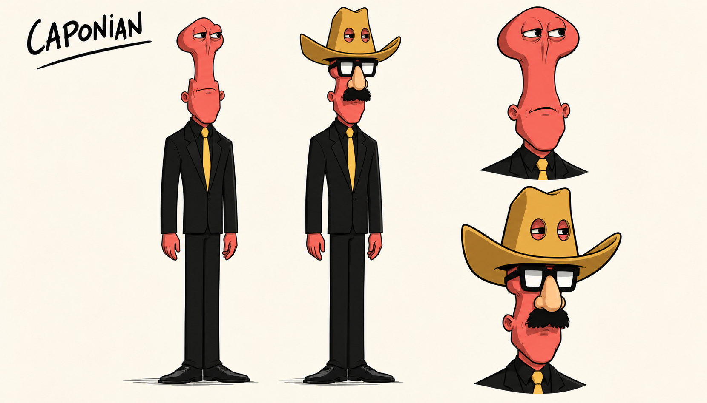

# Zak, Annie og korrigert Caponian: figurpiloter

Laget 13. oktober 2026 etter Toms bestilling, vedlagte illustrasjon og senere Caponian-rettelser. Tre aktive pilotark i en lett leken, Purcell-inspirert 2D-stil. Zak og Annie har tre hele figurer og tre ansiktsuttrykk hver, 1659 x 948. Gjeldende Caponian v3 har to helfigurer og to større byster, henholdsvis umaskert og med cowboyforkledning, 1660 x 948. Alle er RGB PNG med lys bakgrunn.

**Caponian v1 er avvist; v2 er erstattet etter Toms nye presisering.** V2 var mye bedre, men hadde fortsatt feil øyeplassering, for jevnbredt hode og manglet øyehull i hatten. Ingen av dem brukes som bildeanker for v3. Se [gjeldende rettelse med de tre nye referansene](CAPONIAN-RETTELSE-03.md) og [historisk v2-grunnlag](CAPONIAN-RETTELSE.md).

## Bildene

[Zak i full størrelse](zak-pilot-v1.png) · [Annie i full størrelse](annie-pilot-v1.png)

[Korrigert Caponian i full størrelse](caponian-pilot-v3.png)

Zak beholder blå skjorte, rødt slips, mørke bukser, brunt belte og den karakteristiske hårlokken fra vedlegget. Annie følger vedleggets svarte skulderlange hår, blå høyhalsede genser og mørke bukser. Hennes blå drakt er et pilotvalg fra vedlegget; FM-Towns-originalen har rosa/magenta overdel og sko. Skoenes utforming og baksidevisningene er konseptforslag der vedlegget ikke viser detaljene.

Caponian v3 har ekte øyne helt høyt i øvre skalle, et langt innsnevret midtparti og bredere underansikt. De ekte øynene ser ut gjennom to hull høyt i cowboyhattens krone. De lavere Groucho-brillene, den falske nesen og barten er forkledning. Korallfarget hud, mørk dress, smalt gult slips og gulbrun hatt følger de nye referansene. The King brukes kun som anatomisk støtte, uten å overføre hans hvite drakt, hår eller smykker. Begge helfigurene har rette ben.

## Metode og kontroll

Innebygd ChatGPT-bildegenerator: ett forsøk hver for Zak og Annie, og tre Caponian-forsøk totalt. Eksakt modellnavn er ikke eksponert. Ingen ekstern bildetjeneste eller etterbehandling. Zak-arket ble visuelt kontrollert før det ble brukt som ekstra stilreferanse for Annie og Caponian. Det første vedlegget styrer Zak og Annie; de tre nye vedleggene og siste presisering styrer Caponian v3. Purcell-referansen styrer kun tegnebehandling. Se [briefen](BRIEF.md), [Zak-prompten](zak-prompt-01.txt), [Annie-prompten](annie-prompt-01.txt), [gjeldende Caponian-prompt](caponian-prompt-03.txt) og [kilder og sjekksummer](manifest.json).

Tidligere kontroll av Caponian v1 og v2 var utilstrekkelig: v1 hadde vesentlige identitetsfeil, og v2-kontrollen fanget ikke opp øyeplassering, innsnevret hode og øyehull. Disse vurderingene skal ikke brukes som bevis for at de gamle arkene er korrekte. Hovedagent og en separat kontrollør har kontrollert v3 mot de nye originalreferansene og finner de etterspurte trekkene lesbare. Tomme hender er et bevisst valg for designstudiene. Ingen Sam & Max-figurer eller rekvisitter er overført.

Stilforbehold: Menneskefigurene er mer velstelte og konvensjonelt tiltalende enn de grovere Purcell-karikaturene. Annie er noe mer ungdommelig og storøyd enn i vedlegget. Øyne, kinn og klesfolder er noe mer detaljerte enn stilankeret, og Zak og Annie bruker svært like demonstrasjonspositurer. Piloten viser en mild Purcell-inspirert retning. Dette er synlige designvalg for videre stilvurdering, ikke en påstand om å ha kopiert Purcells håndtegning nøyaktig.

Caponian v3 har et dempet, tørt humoristisk uttrykk. Toppen av skallen er bredere og rundere, og underkjeven glattere, enn den kantete Moai-lesningen av pikselreferansene. Visuell kontroll og denne stilforskjellen er dokumentert i [rettelsesnotatet](CAPONIAN-RETTELSE-03.md); dette er ikke Toms godkjenning. Rette ben på arket beviser ikke knefri tripping; gåanimasjonen er ikke laget eller testet.

PNG-filer, dimensjoner, SHA-256, byteidentiske referansekopier og dokumentlenker er kontrollert. Ingen kode er endret, og ingen kode-/motortester er kjørt.

Status: **konseptkandidater til stilvurdering**. Ikke godkjente hovedark eller spritesheets, ingen originalrute-/animasjonskobling, motorimport eller spilltest. Eksisterende produksjonsordre og spillressurser er beholdt.
