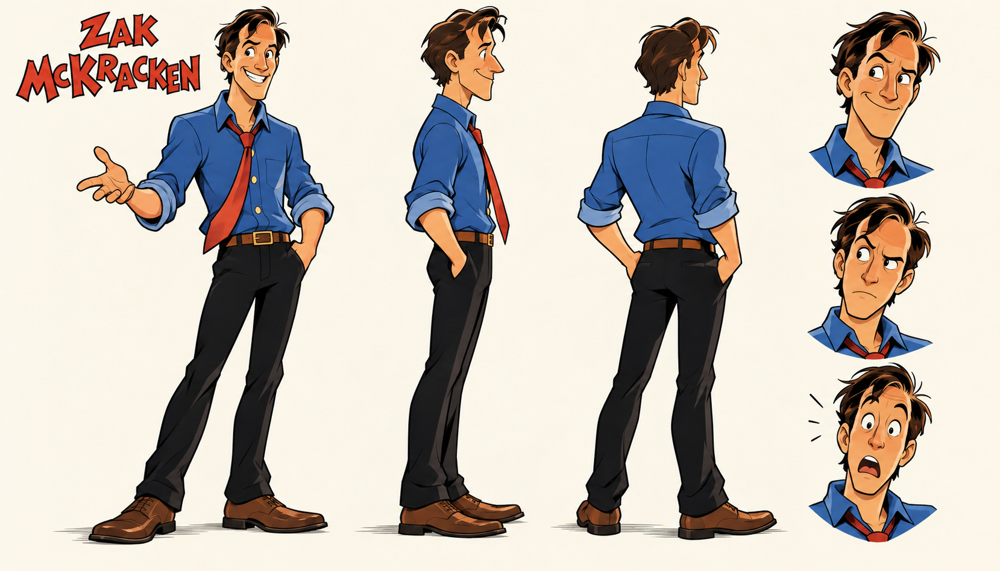
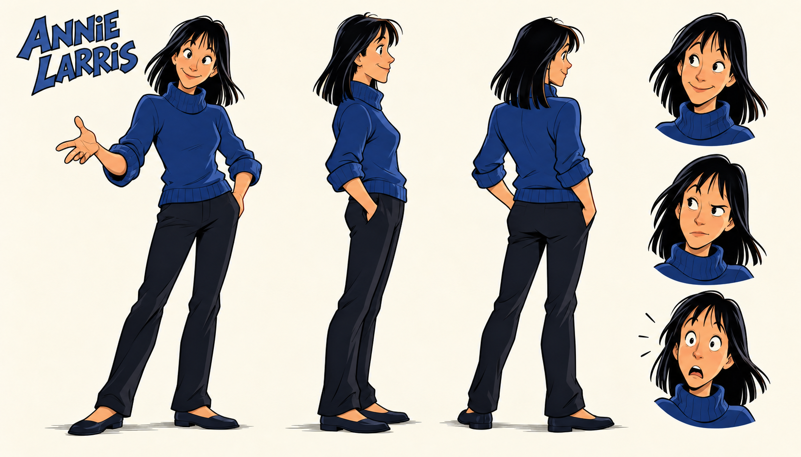
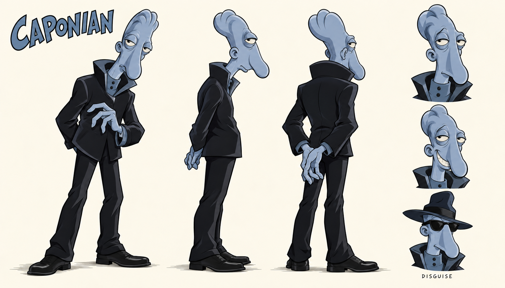

# Zak, Annie og Caponian: første figurpiloter

Laget 13. oktober 2026 etter Toms bestilling og vedlagte illustrasjon. Tre separate pilotark i en lett leken, Purcell-inspirert 2D-stil. Zak og Annie har tre hele figurer og tre ansiktsuttrykk hver. Caponian har tre hele figurer, to uttrykk og én forkledningsbyste. Alle har størrelse 1659 x 948, RGB PNG med lys bakgrunn.

## Bildene

[Zak i full størrelse](zak-pilot-v1.png) · [Annie i full størrelse](annie-pilot-v1.png)

[Caponian i full størrelse](caponian-pilot-v1.png)

Zak beholder blå skjorte, rødt slips, mørke bukser, brunt belte og den karakteristiske hårlokken fra vedlegget. Annie følger vedleggets svarte skulderlange hår, blå høyhalsede genser og mørke bukser. Hennes blå drakt er et pilotvalg fra vedlegget; FM-Towns-originalen har rosa/magenta overdel og sko. Skoenes utforming og baksidevisningene er konseptforslag der vedlegget ikke viser detaljene.

Caponian følger den blågrå, langnesede figuren nederst i vedlegget. Hovedvinklene er uten hatt og briller, mens den lille forkledningsvarianten viser begge deler. Vanlig Caponian er skilt fra The King. Blågrå hud og detaljer i den mørke drakten er konseptvalg fra illustrasjonen; originalskjermbildet viser varmere hudfarge. Nye bakside- og underkroppsdetaljer er forslag.

## Metode og kontroll

Innebygd ChatGPT-bildegenerator, ett forsøk per figur. Eksakt modellnavn er ikke eksponert. Ingen ekstern bildetjeneste eller etterbehandling. Zak-arket ble visuelt kontrollert før det ble brukt som ekstra stilreferanse for Annie og Caponian. Brukervedlegget styrer persondesign; Purcell-referansen styrer kun tegnebehandling. Se [briefen](BRIEF.md), [Zak-prompten](zak-prompt-01.txt), [Annie-prompten](annie-prompt-01.txt), [Caponian-prompten](caponian-prompt-01.txt) og [kilder og sjekksummer](manifest.json).

Hovedagent og en uavhengig agent har sett arkene og sammenlignet med vedlegget og stilreferansen. Hår/hodeform, klær, hovedfarger og kroppstype henger sammen mellom vinklene. Tomme hender er et bevisst valg for designstudiene. Ingen Sam & Max-figurer eller rekvisitter er overført.

Stilforbehold: Menneskefigurene er mer velstelte og konvensjonelt tiltalende enn de grovere Purcell-karikaturene. Annie er noe mer ungdommelig og storøyd enn i vedlegget. Øyne, kinn og klesfolder er noe mer detaljerte enn stilankeret, og Zak og Annie bruker svært like demonstrasjonspositurer. Piloten viser en mild Purcell-inspirert retning. Dette er synlige designvalg for videre stilvurdering, ikke en påstand om å ha kopiert Purcells håndtegning nøyaktig.

Caponian har en friere og svært slank helkroppstolkning fordi vedlegget hovedsakelig viser overkroppen. Drakten har tydeligere skreddersøm og krage, og smileportrettet er mindre truende. Ingen vesentlig identitetsfeil ble funnet i den separate visuelle kontrollen.

PNG-filer, dimensjoner, SHA-256, byteidentiske referansekopier og dokumentlenker er kontrollert. Ingen kode er endret, og ingen kode-/motortester er kjørt.

Status: **konseptkandidater til stilvurdering**. Ikke godkjente hovedark eller spritesheets, ingen originalrute-/animasjonskobling, motorimport eller spilltest. Eksisterende produksjonsordre og spillressurser er beholdt.
