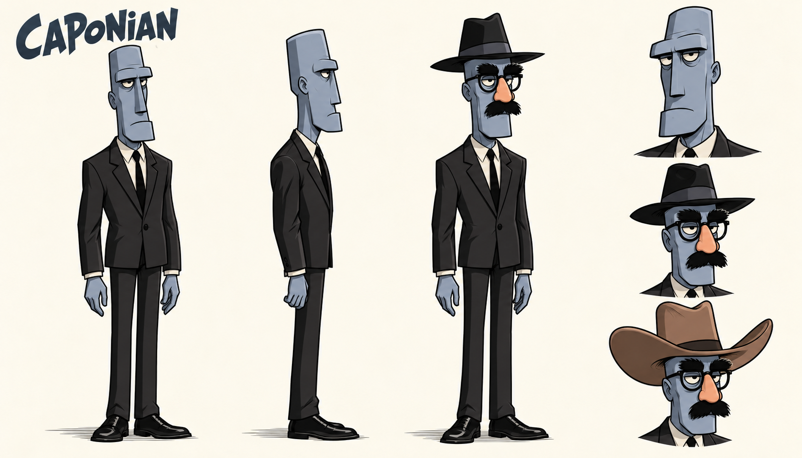

# Zak, Annie og korrigert Caponian: figurpiloter

Laget 13. oktober 2026 etter Toms bestilling, vedlagte illustrasjon og senere Caponian-rettelse. Tre aktive pilotark i en lett leken, Purcell-inspirert 2D-stil. Zak og Annie har tre hele figurer og tre ansiktsuttrykk hver. Gjeldende Caponian v2 har to umaskerte helfigurer, én forkledd helfigur og tre byster: umaskert, fedora og cowboyhatt. Alle har størrelse 1659 x 948, RGB PNG med lys bakgrunn.

**Caponian v1 er avvist av Tom.** Den feilaktige anatomien og forkledningen er erstattet av v2 nedenfor. V1 er bare bevart som historikk, ikke som designanker. Se [rettelsen](CAPONIAN-RETTELSE.md).

## Bildene

[Zak i full størrelse](zak-pilot-v1.png) · [Annie i full størrelse](annie-pilot-v1.png)

[Korrigert Caponian i full størrelse](caponian-pilot-v2.png)

Zak beholder blå skjorte, rødt slips, mørke bukser, brunt belte og den karakteristiske hårlokken fra vedlegget. Annie følger vedleggets svarte skulderlange hår, blå høyhalsede genser og mørke bukser. Hennes blå drakt er et pilotvalg fra vedlegget; FM-Towns-originalen har rosa/magenta overdel og sko. Skoenes utforming og baksidevisningene er konseptforslag der vedlegget ikke viser detaljene.

Caponian v2 følger Toms presisering: høyt firkantet Moai-lignende ansikt, levende hud, mørk dress, rette ben uten kneledd og Groucho-briller med separat falsk nese og svart bart. Fedora og ten-gallon cowboyhatt vises på samme type romvesen. Vanlig Caponian er skilt fra The King. Blågrå hud er fortsatt en pilotpalett; originalskjermbildet viser varmere hudfarge.

## Metode og kontroll

Innebygd ChatGPT-bildegenerator: ett forsøk hver for Zak og Annie, og to Caponian-forsøk totalt, hvorav første er avvist. Eksakt modellnavn er ikke eksponert. Ingen ekstern bildetjeneste eller etterbehandling. Zak-arket ble visuelt kontrollert før det ble brukt som ekstra stilreferanse for Annie og Caponian. Vedlegget styrer Zak og Annie; brukerens senere anatomibeskrivelse styrer Caponian v2. Purcell-referansen styrer kun tegnebehandling. Se [briefen](BRIEF.md), [Zak-prompten](zak-prompt-01.txt), [Annie-prompten](annie-prompt-01.txt), [korrigert Caponian-prompt](caponian-prompt-02.txt) og [kilder og sjekksummer](manifest.json).

Hovedagent og en uavhengig agent har sett de aktive arkene. Caponian v2 er særskilt kontrollert mot brukerens rettelse av en ny agent: firkantede ansikter, alle tre komplette Groucho-forkledninger, mørke dresser og rette ben. V1-kontrollen var utilstrekkelig og overså de feilene Tom påpekte. Tomme hender er et bevisst valg for designstudiene. Ingen Sam & Max-figurer eller rekvisitter er overført.

Stilforbehold: Menneskefigurene er mer velstelte og konvensjonelt tiltalende enn de grovere Purcell-karikaturene. Annie er noe mer ungdommelig og storøyd enn i vedlegget. Øyne, kinn og klesfolder er noe mer detaljerte enn stilankeret, og Zak og Annie bruker svært like demonstrasjonspositurer. Piloten viser en mild Purcell-inspirert retning. Dette er synlige designvalg for videre stilvurdering, ikke en påstand om å ha kopiert Purcells håndtegning nøyaktig.

Caponian v2 har et dempet, tørt humoristisk uttrykk. Hovedagent og separat kontrollør fant ingen vesentlig synlig motsigelse til de presiserte designkravene. Dette er vår vurdering av stillbildet, ikke Toms godkjenning. Rette ben på arket beviser ikke knefri tripping; gåanimasjonen er ikke laget eller testet.

PNG-filer, dimensjoner, SHA-256, byteidentiske referansekopier og dokumentlenker er kontrollert. Ingen kode er endret, og ingen kode-/motortester er kjørt.

Status: **konseptkandidater til stilvurdering**. Ikke godkjente hovedark eller spritesheets, ingen originalrute-/animasjonskobling, motorimport eller spilltest. Eksisterende produksjonsordre og spillressurser er beholdt.
