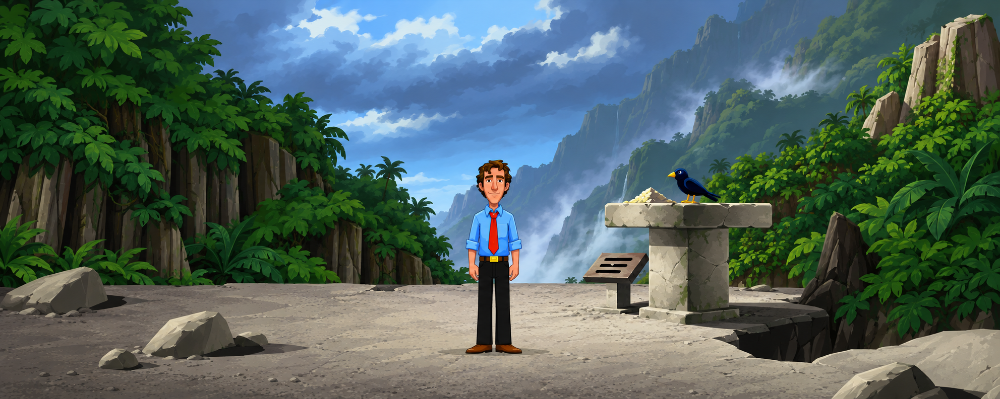

# Zak, rom 42: konsept i Sam & Max-stil

Én konseptkandidat laget 13. oktober 2026 på Toms bestilling. Originalens jungelscene er nytegnet med det godkjente Sam & Max-kontoret som stilreferanse. Selve romfeltet vises uten verbpanel og inventar.

## Leveranse

- [Konseptbilde](zak-rom042-sammax-konsept-v1.png): 1983 x 793, RGB PNG, omtrent 2,5:1. Generatoren leverte denne størrelsen selv om prompten foreslo 2560 x 1024. Ingen oppskalering eller etterbehandling.
- [Originalreferanse](referanser/zak-rom042-original.png): uendret FM-Towns-skjermbilde fra [ScummVM](https://www.scummvm.org/data/screenshots/scumm/zak/zak_fmtowns_en_1_1_full.png).
- [Godkjent Sam & Max-stilreferanse](referanser/sammax-godkjent-kontor.png): samlet kontorscene fra dagens godkjente stilpilot.
- [Brief og metodegrunnlag](BRIEF.md), [faktisk prompt](prompt-forsok-01.txt) og [proveniens med SHA-256](manifest.json).

Laget med innebygd ChatGPT-bildegenerator, ett forsøk. Eksakt modellnavn er ikke eksponert av verktøyet.

## Visuell kontroll

Konseptet og begge referanser er sett og sammenlignet av hovedagent og en uavhengig agent. Zak, fuglen, fuglemateren, skiltet, jungelen, fjellutsynet og gangflaten er bevart som gjenkjennelige elementer. Zaks størrelse og fotlinje ligger nær kilden, og klærnes hovedfarger er beholdt. Ingen figurer eller rekvisitter fra Sam & Max-kontoret er overført.

Tre synlige avvik er relevante for en eventuell neste runde:

1. Zak har et glattere, vennligere ansikt, noe fyldigere hår og tydeligere øyne enn originalen.
2. Landskapet er mer detaljert og malerisk enn kontorankeret, særlig blader, grus, fjell og skyer. En neste stilprøve kan forenkle disse flatene.
3. Fuglens silhuett, steinsprekker og skiltmerker er tolket friere. Dette er ikke pikselnøyaktige produksjonsformer.

Prøven er egnet til å vurdere retningen. Den er ikke merket godkjent av Tom. Ingen spritesheet, animasjon, motorimport, spilltest eller publisert spillpakke inngår i denne leveransen. Eksisterende Zak-stilkrav og produksjonsordre er ikke endret.

## Teknisk kontroll

PNG-filen er åpnet og visuelt inspisert. Dimensjoner, filformat, SHA-256 og byteidentiske referansekopier er kontrollert. Dokumentlenker og Git-diff er kontrollert. Ingen kode er endret, og kode-/motortester er derfor ikke kjørt.
